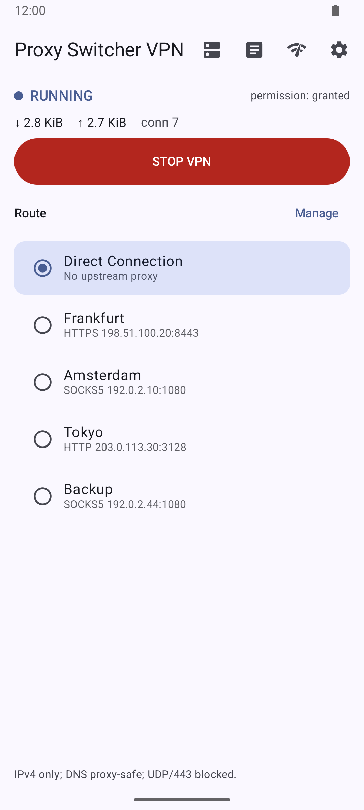
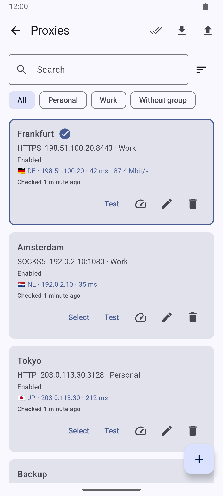
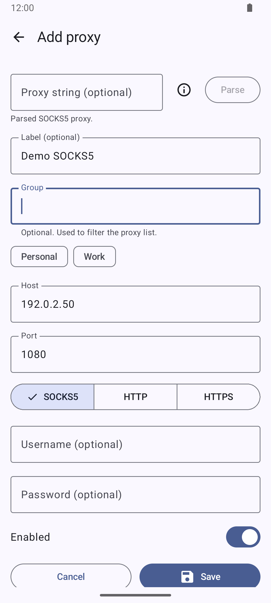
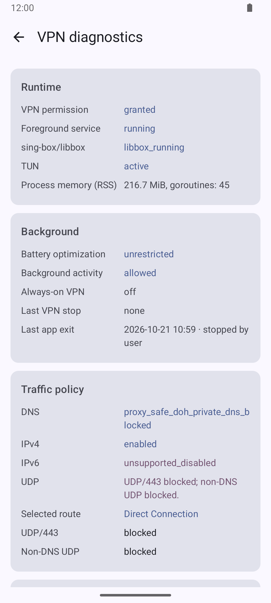
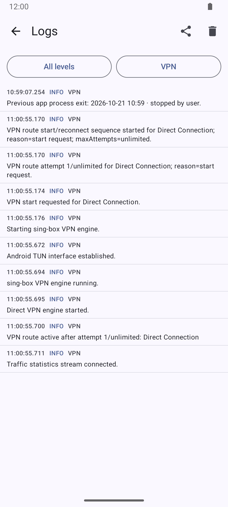

<p align="center">
  
</p>

<h1 align="center">Proxy Switcher VPN</h1>

<p align="center">
  <a href="https://github.com/hightemp/proxy_switcher_vpn/releases/latest"></a>
  <a href="https://github.com/hightemp/proxy_switcher_vpn/releases"></a>
  <a href="https://github.com/hightemp/proxy_switcher_vpn/actions/workflows/android-ci.yml"></a>
  <a href="LICENSE"></a>
  <a href="https://developer.android.com/about/versions/nougat"></a>
  <a href="https://kotlinlang.org/"></a>
  
</p>

<p align="center"><a href="README.md">English</a> · <a href="README.ru.md">Русский</a> · <a href="README.uk.md">Українська</a> · <a href="README.de.md">Deutsch</a> · <a href="README.fr.md">Français</a> · <a href="README.es.md">Español</a> · <b>Italiano</b> · <a href="README.pt-BR.md">Português (Brasil)</a> · <a href="README.pl.md">Polski</a> · <a href="README.zh-CN.md">简体中文</a> · <a href="README.ja.md">日本語</a> · <a href="README.ko.md">한국어</a></p>

App Android che esegue una VPN locale e instrada il traffico del dispositivo
attraverso il proxy upstream selezionato o la modalità Diretta scelta
esplicitamente.

L’app non modifica le impostazioni proxy di sistema di Android. Usa
`VpnService` e un core sing-box integrato.

## Screenshot

Acquisiti dall’app di debug (v0.4.1) su Android API 35. I profili proxy usano
solo indirizzi TEST-NET riservati e non contengono credenziali; i risultati delle
verifiche dei proxy sono dati di esempio.

<table>
  <tr>
    <th>Home — VPN attiva</th>
    <th>Profili proxy</th>
  </tr>
  <tr>
    <td align="center"></td>
    <td align="center"></td>
  </tr>
  <tr>
    <th>Aggiungi proxy</th>
    <th>Diagnostica VPN</th>
  </tr>
  <tr>
    <td align="center"></td>
    <td align="center"></td>
  </tr>
  <tr>
    <th colspan="2">Log VPN filtrati</th>
  </tr>
  <tr>
    <td colspan="2" align="center"></td>
  </tr>
</table>

## Lingue

L’app è disponibile in inglese, russo, ucraino, tedesco, francese, spagnolo,
italiano, portoghese (Brasile), polacco, cinese (semplificato), giapponese e
coreano. Segue la lingua di sistema; puoi anche scegliere una lingua in
Impostazioni → Lingua oppure, su Android 13+, nelle impostazioni di sistema
della lingua per app. Le voci di log e i valori tecnici della diagnostica
restano in inglese, così le segnalazioni di bug sono facili da leggere.

## Limiti

- solo IPv4;
- IPv6 non è esplicitamente supportato;
- UDP/443 è bloccato per impostazione predefinita per evitare che QUIC/HTTP3
  aggiri il proxy;
- se il proxy upstream selezionato resta irraggiungibile dopo i tentativi, la
  VPN si arresta in modalità fail-closed;
- la modalità Diretta è esplicita e non viene mai usata come ripiego
  silenzioso;
- le password dei proxy sono mascherate nell’interfaccia, nei log e nella
  diagnostica.

## Mantenere attiva la VPN

Android, e in particolare Samsung One UI, può chiudere il processo dell’app in
background. Per mantenere attiva la VPN:

- consenti all’app di funzionare in background (finché l’ottimizzazione della
  batteria è attiva, la Home mostra un avviso con «Consenti»); su Samsung
  rimuovila anche dalle «App in sospensione»;
- se vuoi, attiva la VPN sempre attiva nelle impostazioni VPN di Android
  (finestra Impostazioni → VPN sempre attiva). Insieme a «Blocca connessioni
  senza VPN» funziona come kill switch: nessun traffico lascia il dispositivo
  mentre la VPN non è attiva.

Se il processo viene chiuso con la VPN attivata, l’app ripristina la VPN entro
uno o due minuti. La diagnostica mostra il motivo dell’ultimo arresto della
VPN e dell’ultima chiusura dell’app.

## Compilazione

```bash
make test
make build-local
```

La prima compilazione scarica l’AAR sing-box/libbox fissato (circa 97 MB)
nella cache Gradle dell’utente. `gradle/libbox.properties` fissa la revisione
del sorgente, l’URL immutabile dell’artefatto, la dimensione e lo SHA-256. Ogni
compilazione verifica l’hash e le ABI native richieste prima di compilare. Per
scaricarlo esplicitamente:

```bash
make fetch-libbox
```

APK di debug:

```text
app/build/outputs/apk/debug/app-debug.apk
```

Installazione su un dispositivo collegato:

```bash
make install
```

## Log di debug

L’app scrive log di esecuzione ripuliti nella schermata Log e in Android
logcat:

```bash
adb logcat -s ProxySwitcherVPN
```

I log includono la selezione del percorso, i test dei proxy, i risultati del
monitoraggio del proxy, i tentativi di riconnessione, le attese, la
configurazione del TUN, il ciclo di vita del motore e i motivi finali degli
arresti fail-closed. Le password dei proxy sono mascherate.

## Rilascio

La versione viene letta da `VERSION`.

```bash
make update-version
make release
```

`make release` aggiorna `versionCode`/`versionName` in Gradle, esegue i
controlli, compila la release, crea commit e tag e fa il push del tag.

Una release firmata richiede `keystore.properties`. Non fare commit di segreti
o del keystore.

## Licenza

Proxy Switcher VPN è distribuito con licenza
[GNU GPL v3 o successiva](LICENSE). Le release includono sing-box/libbox,
quindi chi le distribuisce deve anche conservare le note sui componenti di
terze parti e fornire il sorgente corrispondente esatto richiesto dalla GPLv3.
Vedi le [note sui componenti di terze parti](THIRD_PARTY_NOTICES.md) e
l’[audit delle licenze delle dipendenze](docs/legal/dependency-license-audit.md).
